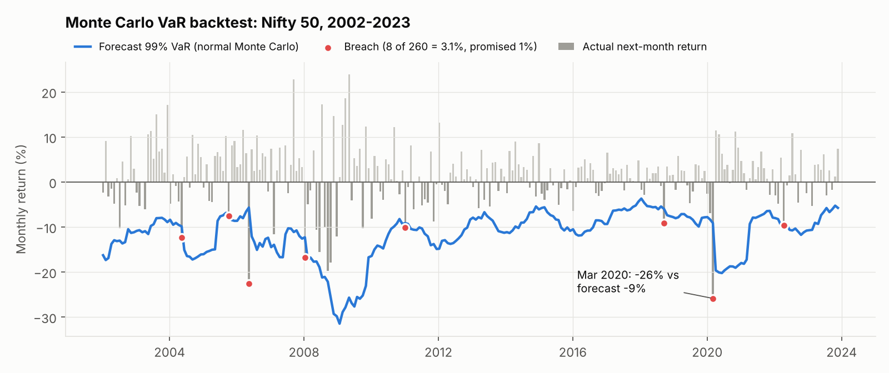
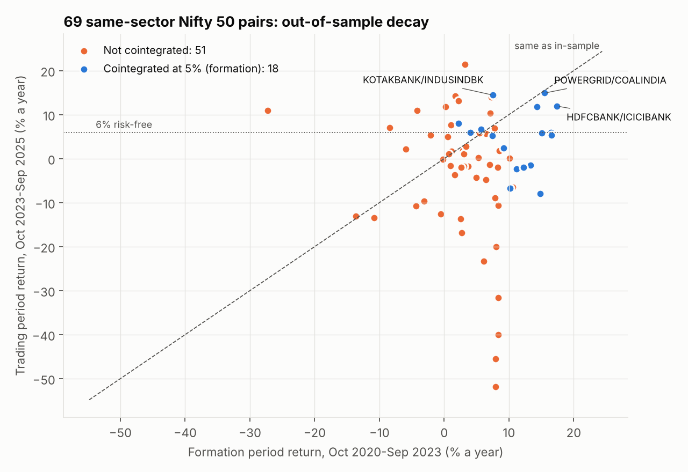
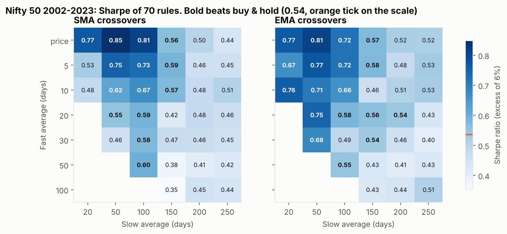
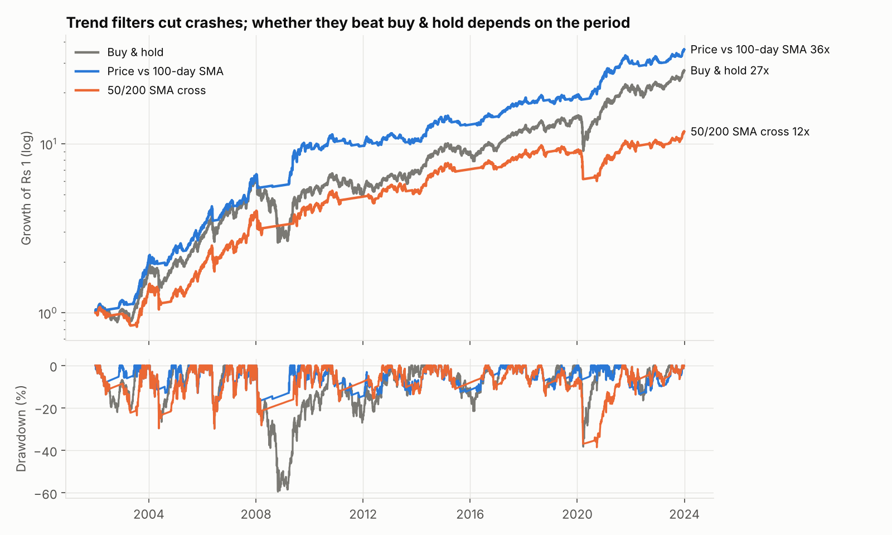
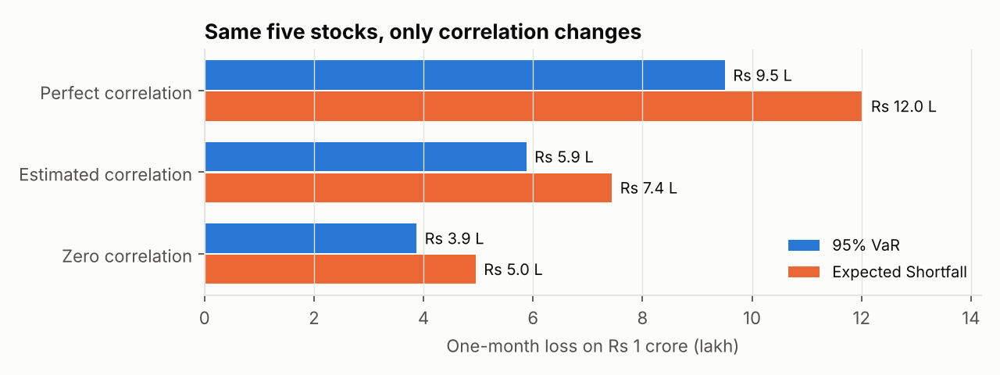

# quantlab: honest backtests on Indian equities

Three classic quant strategies, built from scratch in Python (NumPy and pandas only)
and stress-tested on real NSE data: **Monte Carlo Value at Risk**, **pairs trading
(statistical arbitrage)** and **moving-average trend following**.

The point of the project is the testing, not the strategies:
- every backtest trades one day after its signal, so it never uses future data;
- every trade pays India's real statutory charges (STT, stamp duty, exchange and SEBI fees, GST);
- every strategy is compared against buy and hold and a 6% risk-free rate;
- every "best" parameter is re-checked on data it was not chosen on.

**Interactive version:** the `dashboard/` folder next to this project has a live page with these studies (trend explorer, VaR backtest, pairs table).

## Key findings

| Question | Answer from the data |
|---|---|
| Does Monte Carlo VaR hold up? | **No, it underestimates crashes.** The 99% monthly VaR on the Nifty 50 was breached 3.1% of the time over 2002-2023, three times the promised 1%. March 2020 lost 26% against a forecast of 9%. Fat-tailed shocks didn't help; recent-weighted volatility (EWMA) made it worse. |
| Does correlation matter? | **It's the main driver.** For a Rs 1 crore, five-stock portfolio, one-month 95% VaR is Rs 3.9 lakh at zero correlation, Rs 5.9 lakh at the estimated correlation and Rs 9.5 lakh at perfect correlation. Correlation was 0.24 in calm quarters and 0.34 in volatile ones. |
| Do cointegrated pairs keep working? | **Mostly not.** 18 of 69 same-sector Nifty 50 pairs tested as cointegrated in 2020-2023. None still passed in 2023-2025, and their average return fell from 10.9% to 4.7% a year. Only 6 of 18 beat the risk-free rate. |
| Which moving-average crossover is best? | **None reliably.** Over 70 SMA/EMA rules, the famous 50/200 cross ranked 67th (Sharpe 0.41 vs 0.54 for buy and hold). The five rules picked on 2002-2012 data all trailed buy and hold on return in 2013-2023 (11-13% vs 14.3% a year), but cut the worst loss from -38% to between -11% and -21%. SMA vs EMA barely matters. |











## Methods

**Monte Carlo VaR** (`quantlab/risk.py`): estimates means and the covariance matrix
from daily log returns, uses a Cholesky decomposition to make correlated shocks,
and simulates 10,000 one-month paths. It reads VaR and Expected Shortfall off the
simulated P&L. The backtest re-fits monthly on a trailing year and compares four
shock models: normal, multivariate Student-t (df = 4), historical bootstrap and
EWMA (lambda = 0.94).

**Pairs trading** (`quantlab/pairs.py`): Engle-Granger test (OLS hedge ratio, then
an ADF test on the residuals against MacKinnon critical values), implemented from
scratch. It trades a 60-day rolling z-score of the spread: enter at ±2, exit at 0.
The hedge ratio is frozen on the formation window. Both legs are costed as NSE
stock futures, because Indian cash-market shorts can't be held overnight. The scan
covers only same-sector pairs, to limit false discoveries from multiple testing.

**Trend following** (`quantlab/trend.py`): long/flat SMA or EMA crossovers with a
one-day execution lag, separate buy and sell costs, cash earning the risk-free
rate, and dividends added back to the price index. The sweep covers 70 rules,
with a walk-forward split (choose rules on 2002-2012, test on 2013-2023) and
results by market period.

**Transaction costs** (`quantlab/costs.py`): NSE charges after the Budget 2026
STT revision. Round trips cost 32 bps for delivery equity, 12 bps for ETFs and
16 bps for stock futures, including 5 bps of slippage per side.

## Project structure

```
quantlab/          library: data, costs, stats, risk, pairs, trend
scripts/           command-line analyses (one per study) + make_figures.py
tests/             17 pytest tests: cost math, OLS/ADF, VaR calibration, no look-ahead
results/           figures used above
data/              fetch_data.sh (datasets are downloaded, not committed)
docs/GUIDE.md      step-by-step learning guide to each method (also docs/guide.pdf)
```

## Run it

```bash
pip install -e ".[dev,data]"
make test            # unit tests
make reproduce       # download data, regenerate figures, re-run every study

# or individually, on any ticker via yfinance (NSE tickers end in .NS)
python scripts/monte_carlo_var.py --tickers RELIANCE.NS TCS.NS HDFCBANK.NS
python scripts/pairs_trading.py --a HDFCBANK.NS --b ICICIBANK.NS
python scripts/ma_sweep.py --ticker NIFTYBEES.NS
python -m quantlab.costs                      # print the NSE cost model
```

Every script also runs offline with `--synthetic`.

## Data and limitations

- **Sources.** Nifty 50 index daily closes (2001-2023) and 50 Nifty 50 stocks
  (Oct 2020-Sep 2025) come from public GitHub datasets (`data/fetch_data.sh`),
  not from NSE directly.
- **Price index.** The index is a price index, so a 1.3% a year dividend yield is
  added back.
- **Survivorship.** The stock universe is today's Nifty 50, which flatters
  long-only results.
- **Not modelled.** Futures lot sizes, rollover, basis, F&O ban periods, circuit
  limits and taxes.
- **Statistical power.** Two years is a short window for re-testing cointegration,
  so "none still cointegrated" partly reflects low test power.

Educational research code, not investment advice.
