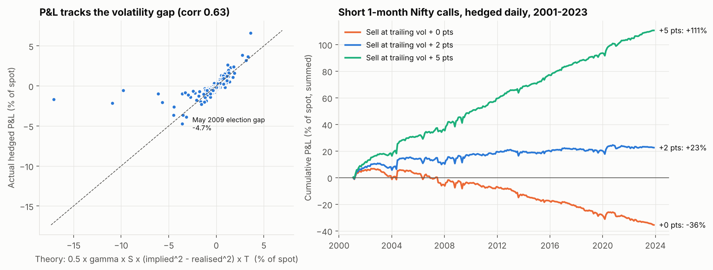
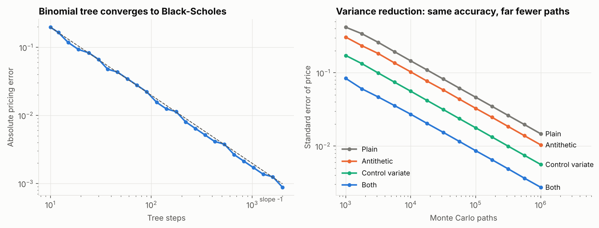
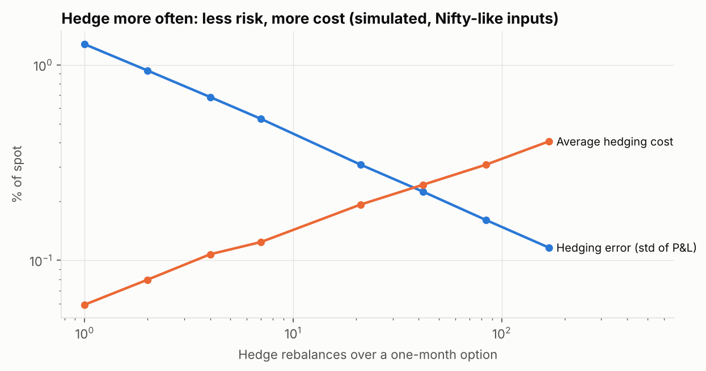
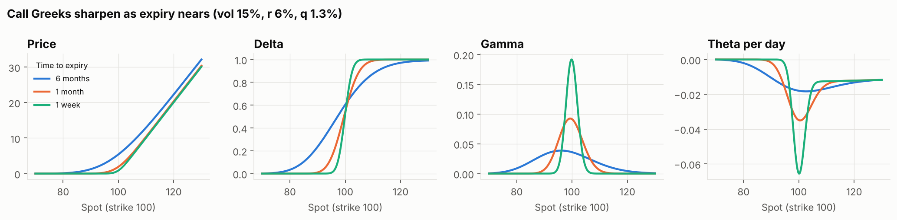

# optlab: option pricing and delta hedging on Nifty 50

Three option pricers built from scratch in Python and checked against each other:
Black-Scholes, a binomial tree and Monte Carlo. Also the Greeks, implied
volatility, and a 22-year **delta-hedging backtest on real Nifty 50 price paths**
with NSE futures costs.

## Key findings

| Question | Answer |
|---|---|
| Do the three pricers agree? | **Yes.** The binomial tree converges to Black-Scholes at rate 1/steps (error under 0.001 at 2,000 steps). Monte Carlo lands within 3 standard errors, and all Greeks match finite differences to 1e-5. |
| How much does variance reduction help Monte Carlo? | **About 28x fewer paths.** Antithetic variates plus a control variate cut the standard error from 0.046 to 0.0088 at 100,000 paths, which plain simulation would need about 2.8 million paths to match. |
| What does a delta-hedged option actually earn? | **The gap between the volatility you sold at and the volatility that happened.** On 271 monthly Nifty calls (2001-2023), hedged P&L correlates 0.63 with the textbook gamma term 0.5·Γ·S²·(σ²implied − σ²realised)·T. |
| Can you sell Nifty options at recent realised volatility? | **No.** Pricing at trailing 21-day volatility loses 0.13% of spot a month and wins only 33% of months. Without costs it would make +0.06%, so the futures hedging costs (0.19% a month) decide the outcome. You need to sell about 1-2 volatility points above recent volatility to break even. |
| How often should you hedge? | **Daily on real data.** Monthly P&L volatility was 1.0% hedging daily, 1.5% weekly and 2.3% never. The worst month went from -4.7% (May 2009 election gap) to -9.1% weekly and -11.6% unhedged. In simulation, hedging error falls like 1/√(rebalances) while cost rises, so there is a trade-off. |









## Markup sweep (sell at trailing 21-day realised volatility + markup)

| Markup | Avg P&L / month | Win rate | Worst month | Sharpe (annualised) |
|---|---|---|---|---|
| 0 pts | -0.13% | 33% | -4.73% | -0.44 |
| 1 pt | -0.02% | 42% | -4.60% | -0.08 |
| 2 pts | +0.08% | 50% | -4.48% | 0.27 |
| 3 pts | +0.19% | 59% | -4.36% | 0.63 |
| 5 pts | +0.41% | 72% | -4.11% | 1.32 |

## What's implemented

| Module | Contents |
|---|---|
| `optlab/bs.py` | Black-Scholes-Merton with dividend yield. Analytic delta, gamma, vega, theta, rho. Put-call parity check. Vectorised over NumPy arrays. |
| `optlab/binomial.py` | Cox-Ross-Rubinstein tree, European and American exercise, early-exercise premium. |
| `optlab/mc.py` | GBM Monte Carlo with antithetic variates and a control variate (discounted terminal price), with honest standard errors. |
| `optlab/iv.py` | Implied volatility by Newton-Raphson on vega, with bisection fallback and no-arbitrage bound checks. |
| `optlab/hedging.py` | Discrete delta-hedging simulator: interest on cash, dividends, proportional costs, any rebalance frequency. |

**36 tests** cover:
- Hull's textbook prices
- put-call parity across strikes and dividend yields
- tree convergence, and the American put premium
- Monte Carlo within 3 standard errors, and the variance-reduction gain
- every Greek against finite differences
- implied-volatility round trips and arbitrage-bound rejection
- hedging error shrinking with rebalance frequency
- selling above realised volatility earning money, and costs reducing P&L

## Run it

```bash
pip install -e ".[dev]"
make test
make reproduce          # downloads Nifty data, regenerates figures, prints the backtest
```

```python
from optlab import bs, binomial, mc, iv
bs.price(S=24000, K=24000, T=30/365, r=0.06, sigma=0.13, kind="call", q=0.013)
bs.greeks(24000, 24000, 30/365, 0.06, 0.13, "put", 0.013)
binomial.price(100, 100, 1, 0.05, 0.2, "put", american=True)
mc.price(100, 100, 1, 0.05, 0.2)                       # (price, standard error)
iv.implied_vol(250.0, 24000, 24000, 30/365, 0.06, "call", 0.013)
```

## Assumptions and limitations

- **No historical option prices.** Implied volatility is modelled as trailing
  realised volatility plus a markup. India VIX usually sits above realised
  volatility, which this backtest does not capture. The markup sweep shows how
  much that premium would need to be.
- **Market inputs.** r = 6%, dividend yield 1.3%. The hedge is Nifty futures at
  7.8 bps per side, the average of the NSE buy and sell costs after the Budget
  2026 STT revision.
- **Not modelled.** Option-leg costs (STT 0.15% of premium on sell), lot sizes,
  margin, futures basis and roll.
- **Data.** Nifty 50 daily closes for 2001-2023 come from a public GitHub dataset
  (`data/fetch_data.sh`).

Educational research code, not investment advice.
